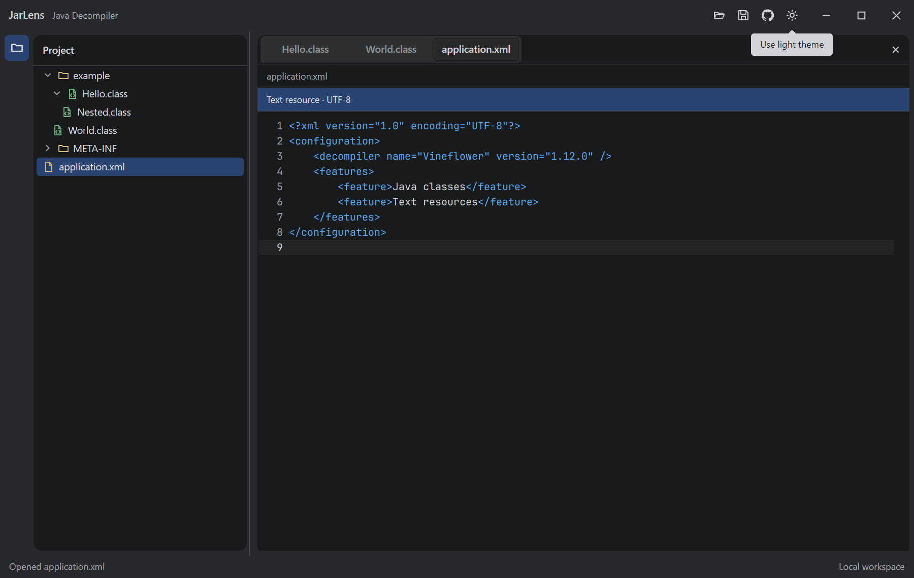
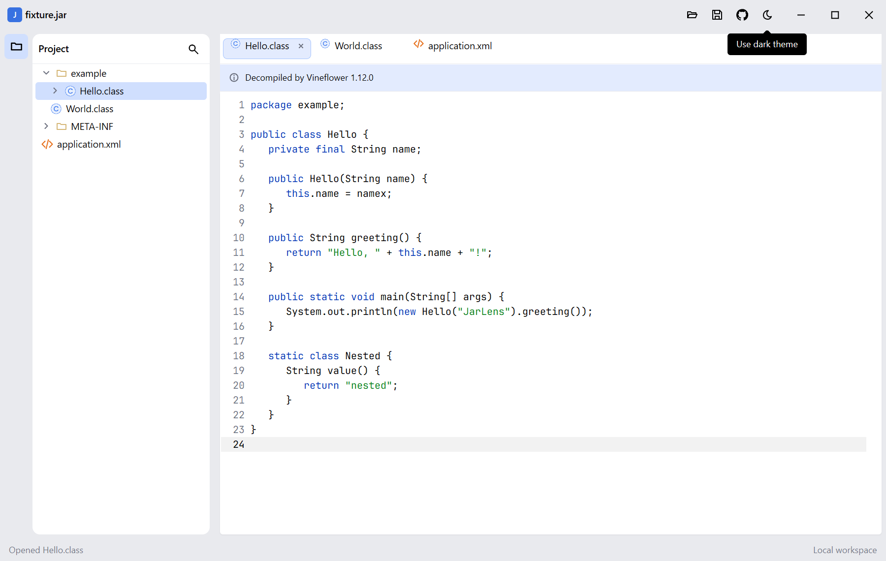
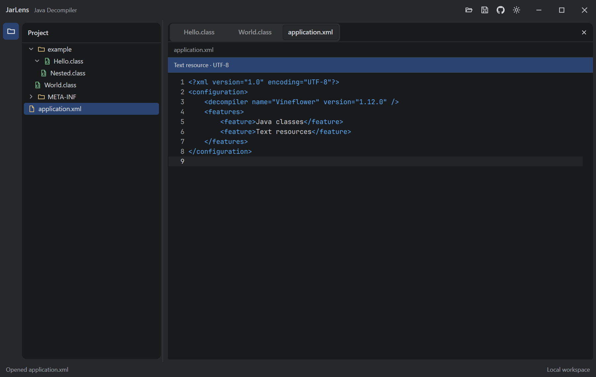

# JarLens design system

## Direction

JarLens uses the IntelliJ IDEA way of working as its interaction model and
[OpenIDEA](https://github.com/l0ng-ai/openidea) as its primary visual reference:
compact tool windows, a project hierarchy, editor tabs, breadcrumbs, command-driven
navigation, and an always-available status bar. The current palette follows
OpenIDEA's Islands theme family.

JarLens is not affiliated with JetBrains. IntelliJ IDEA is a trademark of
JetBrains s.r.o. Layout and interaction patterns may be reproduced; proprietary
resources may not. Open-source icons or other assets require their original
license and attribution when introduced.

## Current native workspace

These images come from the real Windows amd64 application at 150% display scale.
They show a populated multi-document workspace, real decompiled Java, and both
theme variants.

| Islands Dark | Islands Light |
| --- | --- |
|  |  |

A real JAR decompiled by the embedded Vineflower engine in the native Windows
application:



## Workbench structure

```text
Startup:
Titlebar: product / workspace actions / appearance
Home: open action / drag-and-drop hint / recent projects
Status bar: task state / workspace and engine state

Open workspace:
Titlebar: product / workspace actions / appearance
Project tool window + Editor island
Status bar: task state / workspace and engine state
```

With no archive open, Home is one centered main region without the project tool
window, editor panes, or splitters. It provides the Open action, a drag-and-drop
hint, and recent projects with their names and paths. Choosing a file or a recent
project from Home expands the native window to the screen and replaces Home with
the full workbench. On the next launch, the most recent successfully
opened archive opens directly when startup restoration is enabled. The normal
window placement and maximized state persist in the user configuration directory;
a command-line archive argument takes precedence over startup restoration.

The titlebar is a single integrated Viva `WindowCustomTitlebar`, not a native
system titlebar above an application toolbar. Its empty area moves the window.
`app.TitlebarInsets` reserves platform controls, and themed minimize, maximize,
restore, and close controls retain their native window behavior and accessible
names. The left cluster starts with the JarLens mark and has no hamburger menu.
Home shows a monochrome home icon and Home label without a dropdown; an open
workspace instead shows the current archive title with a dropdown chevron. The title carries its own
initials badge without a tinted background. The archive title opens the project
switcher with Open, JarLens Home, the current project, and recent projects.
Settings is available through the gear button in the right-hand toolbar icon
group and through Primary+Alt+S. Each
project row has a deterministic colored initials badge based on its filename;
rows have no selected background until the user interacts with them. The 12 most
recent successfully opened workspaces persist in the user configuration
directory; selecting one switches directly and clears the previous document set.

Titlebar icon actions use a 30×30 hit area, an 18-pixel glyph, an 8-pixel hover
radius, and delayed tooltips. Compact tool-window and find actions use 24×24 hit
areas. The GitHub action opens the official repository through the operating
system; the sun/moon action switches appearance. Both expose stable accessible
names and keyboard focus rather than relying on icon recognition.

Tool actions stay monochrome for consistency. Package, class, and resource icons
follow OpenIDEA's default IntelliJ Platform mapping. Their SVG sources are compiled
to native vectors in `internal/ui/openideaicons`; `internal/ui/file_icons.go`
selects file types and the matching light or dark palette. Color supports
recognition but never replaces labels, selection state, or accessible text.

- The activity stripe is removed. The project window keeps its outer margins and
  the 6-pixel editor gap. It contains the lazy archive/package/class hierarchy. Its title
  is a 24-pixel dropdown with expand-all, collapse-all, and filter actions. Class
  nodes and editor tabs retain the real `.class` suffix. Tree rows use a 5-pixel
  radius, 6-pixel horizontal inset, 16-pixel disclosure target, and 20 pixels of
  indentation per depth. Rows and icons keep their natural width; long names use
  horizontal scrolling rather than squeezing or ellipsizing them. Only rows near
  the viewport are painted, and content-width measurement is cached across splitter
  drags. The current document keeps the blue selection after navigation; hover is lighter and does not
  replace it. Nested `Outer$Inner.class` entries are
  grouped under `Outer.class` while retaining
  their real entry identity. Anonymous and local classes retain their full binary
  names (`Outer$1.class`, `Outer$1Local.class`) instead of showing numeric-only
  labels. Selecting any class opens its outermost document; anonymous classes
  select the nearest named outer declaration and local classes select their real
  declaration name. Declaration navigation centers its line in the editor viewport when
  scrolling room allows, focuses the editor, and leaves a blinking caret at the
  start of the name instead of creating another tab for a nested class.
- The editor owns multiple independent document tabs, source, diagnostics, and
  search. Repeatedly opening a class activates its existing tab; each tab retains
  its editor and scroll state. Tabs follow OpenIDEA's actual editor component:
  28-pixel height, 6-pixel radius, content-sized labels capped at 260 pixels,
  and a selected pill with a one-pixel inset border rather than an underline.
  Close actions appear on the selected or hovered tab. Hovering the close action
  shows a 16-pixel circular accent target inside its 20-pixel hit area, with a
  pressed state and keyboard focus ring. The current tab can also be closed with
  the primary shortcut+W. A trailing tab-actions menu closes all, other, left, or
  right tabs, disabling actions that do not apply to the active document. The menu
  follows OpenIDEA's 24-pixel rows, 180-pixel minimum width, strong foreground,
  10-pixel surface and 5-pixel current-row radius. Its first action is current when
  opened, and the vertical-more glyph uses the reference theme's warning yellow.
  Right-clicking a tab groups close actions with Split Right and Split Down. Editors
  form a recursive pane tree rather than a fixed primary/secondary pair, so any
  pane can be split repeatedly in either direction. Each leaf is a complete panel
  with its own tab list, provenance banner, active document, caret, selection, and
  scrolling. Provenance banners use 8-pixel horizontal margins, 4-pixel vertical
  margins, and a 6-pixel radius. A 6-pixel frame-colored splitter separates adjacent panels; each
  parent node owns its position, so nested panes resize independently by pointer
  drag or the keyboard arrows. The project
  tree opens documents in the active pane, and tab close actions and the primary
  shortcut+W affect only that pane. Closing its last tab collapses only that leaf
  and promotes its sibling subtree without discarding documents. Switching tabs
  updates the status bar to the visible document.
- Text resources open in the same document workspace with their original filename,
  language-aware presentation, and export suffix. Binary resources are rejected
  with a diagnostic rather than sent to a decompiler.
- Bottom and right tool windows remain hidden until they have useful content.
- Panels are resizable and keyboard accessible when those interactions land.

## Islands metrics

| Element | Baseline |
| --- | --- |
| Titlebar | 40 logical pixels |
| Tool-window header | 40 |
| Editor tab bar | 40 (28-pixel tabs) |
| Editor banner | 36 minimum |
| Status bar | 34 |
| Home content | 480 wide; recent list capped at 420 high |
| Activity stripe | Removed |
| Project window | 300 wide by default |
| Tool/list row | 24 |
| Control | 28 high |
| Island gap | 6 |
| Island radius | 10 |
| Control/row radius | 4–6 |

Views use Viva metrics and theme tokens. A new isolated constant needs a design
reason and must not become a second unofficial theme system.

## Color roles

Both built-in themes use blue `#3871E1` for primary actions and focus. Dark uses
`#191A1C` editor surfaces, `#26282C` frame surfaces, and `#2A4371` selection.
Light uses white editor surfaces, `#E9EAEE` frame surfaces, and `#D0DFFE`
selection. Foreground, muted text, borders, hover, input, success, and danger are
defined per appearance in `internal/ui/theme.go`.

The previous teal accent is superseded. Brand artwork may retain a distinct
identity, but workbench selection and focus follow the semantic blue accent.

## Themes

- **Islands Dark** is the default and appears as **深色** in Settings.
- **Islands Light** appears as **浅色** and is also available through the working
  titlebar theme switch.
- **跟随系统** resolves the workbench through `app.SystemAppearance` and listens
  for operating-system changes with `app.WatchSystemAppearance`. An unknown
  system preference falls back to Dark.
- High Contrast, Solarized, and Atom One are possible future additions, not
  advertised as available.
- Every new theme must define every semantic token, use the same metrics, pass
  behavior and bounds tests, and include populated-workspace screenshots.
- Editor syntax colors use theme-linked, separately identifiable schemes for
  Java and supported text resources.

Theme choice, interface language, UI font, code font and size, Tab width,
indentation guides, line numbers, current-line highlight, Java executable,
startup restoration, automatic update checks, and update source persist in
`settings.json` in the user configuration directory. The settings dialog follows
OpenIDEA: a 240-pixel page tree, breadcrumbs with back/forward history, per-page
Reset, titled section separators, compact form rows, checkboxes, and an inline
footer error. Its tree groups Appearance and System Settings under Appearance and
Behavior, Font and General under Editor, and provides Update Management as a root
page. Search filters pages and highlights matching labels; Escape clears a
non-empty query before dismissing the dialog, while Up/Down changes pages without
leaving the search field. Edits are staged and mark their pages dirty. Apply is
enabled only for pending changes and saves without closing; OK saves and closes;
Cancel discards unapplied edits. The last selected page is remembered across
openings. Update Management selects GitHub or CNB for both update checks and
release history. Five stable releases load per page, with expandable notes,
publication dates, refresh, and load-more controls. GitHub uses its public release
API; CNB reads the public release page without requiring a user token. Opening a
download page requires a user click. The checker never downloads or executes a
package or replaces the running program.

## Typography and source

UI text uses the embedded Inter 4.1 variable font at 13 logical pixels by default,
with 12 for secondary labels and 11 for compact metadata. Source uses embedded
JetBrains Mono at 13 pixels on a character grid. Both are registered only for the
JarLens process, retain their OFL notices, and use system fallback for scripts the
fonts do not cover.

The workspace provides Simplified Chinese, English, Japanese, and Korean for
controls, menus, tooltips, dialogs, settings search, and status messages. The
shared catalog in `internal/ui/i18n.go` and `internal/ui/i18n_catalog.go` resolves
text at paint time, so applying a language updates the open workspace immediately.
Simplified Chinese is the default and fallback for missing translations. Language
names remain in their native scripts, and release-note content remains in the
language supplied by its publisher.

The source view is read-only and includes line numbers, current-line feedback,
selection, bracket matching, vertical and horizontal scrolling, and keyboard
navigation. Compact (2), Default (4), and Relaxed (6) presets reindent the
displayed source and its indentation guides without modifying the original
archive. Java uses brace nesting outside strings, comments, and text blocks;
text resources scale their existing leading-indent levels. Exports match the
displayed indentation. A quiet source-provenance banner names the decompiler and version.
Source find highlights its matches. Resolvable class names in Java and
`META-INF/services` documents are blue, underlined links: clicking opens the target
class, selects its declaration, and reveals the target in the project tree. Opening
or switching documents expands the tree's parents and scrolls the node into view.
Comments, strings, and unresolved names are not links. XML syntax highlighting
separates tag names, attribute names, quoted values, comments, declarations, and
entities rather than coloring the entire angle-bracket block. Folding remains future work.
Decompiled code is identified as generated output; minimap and decorative effects
are not required.

Tooltips use the Islands floating surface: 13-pixel text, 6-pixel radius, no arrow,
and a 600ms hover delay. Editor-tab tooltips show the archive-qualified document
location; close tooltips name the available primary shortcut+W action. Long paths
wrap within a 720-pixel maximum and the popup stays inside the window.

Splitter dragging uses a neutral one-pixel indicator rather than an accent line.
The source surface does not acquire an accent border on click; caret, current line,
and selection communicate focus. Other controls retain their keyboard focus rings.

## Motion and accessibility

Motion is brief and limited to meaningful transitions. Core reading and scrolling
do not animate gratuitously. Every action is keyboard reachable, focus is visible,
contrast targets WCAG AA, and state is expressed with text or iconography in
addition to color. Screen-reader names and high-DPI behavior are acceptance
criteria, not post-release polish.

## Design change evidence

A visual PR includes real before/after screenshots when applicable, platform and
scale, and headless behavior tests. Token changes require both built-in themes and
all affected states to be reviewed, not only an empty welcome page.
